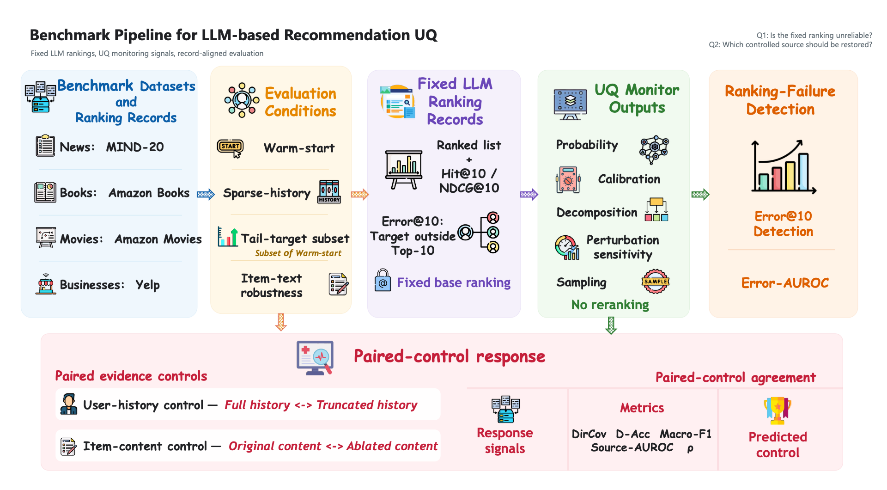

# RecUQ Benchmark

**Towards Realistic Evaluation of Uncertainty Quantification for LLM-Based Recommender Systems**<br>
Hao Wu, Sipeng Chen, Weikai Li, Tianyi Chen, Qiancheng Yang, Hang Zhou, Yizhou Sun, Wei Wang, and Xiao Luo<br>
*Transactions on Machine Learning Research*, 2026 · [Paper on OpenReview](https://openreview.net/forum?id=GXDe6REdu3)

RecUQ compares uncertainty monitors on the **same issued LLM ranking**. Each monitor scores a frozen 20-candidate ranking against two objectives: detecting when the relevant item falls outside the top 10, and measuring whether the monitor responds more strongly to the user-history or item-content control with the larger NDCG@10 difference.

The fixed-ranking protocol exposes changes in monitor ordering across backbones. Top10Mass has the highest pooled Llama Error-AUROC in all four conditions, with a smaller lead on popularity-tail targets. Perturbation Rank Instability and simple ranking distances show stronger agreement with the clipped paired-control labels than the scalar monitors.

[](figures/reference/fig_benchmark_pipeline.pdf)

## Reproduce on CPU

Run from the repository root with Python 3.10 or 3.11.

```bash
python3 -m venv .venv
source .venv/bin/activate
python -m pip install -r requirements-eval.txt
make validate
make reproduce
```

The release includes the fixed rankings and UQ scores needed for evaluation. Reproduction runs locally without a GPU, model weights, or source-dataset downloads. To smoke-test ranking generation with synthetic records, run `python scripts/generate_fixed_rankings.py --dry_run`.

| Command | Result |
| --- | --- |
| `make validate` | Check file hashes, record counts, schemas, joins, and selected paper values. |
| `make reproduce` | Recompute scalar metrics, paired-control metrics, and camera-ready diagnostics. Results go to `outputs/reproduced/`. |
| `make reproduce-full` | Add the paper's Warm-start, instance-clustered, and paired-control bootstrap procedures. |
| `make paper-tables` | Export machine-readable Tables 1–8 from the frozen reference results to `outputs/paper_tables/`. |
| `make figures` | Render the data-derived figures and illustrative case study to `outputs/figures/`. |

Use the [paper results map](docs/PAPER_RESULTS_MAP.md) to locate a table or
figure, and the [CPU evaluation guide](REPRODUCIBILITY.md) for individual evaluator
commands. To rebuild the benchmark inputs or run new inference, follow the
[data reconstruction guide](docs/DATA_RECONSTRUCTION.md) and the
[GPU regeneration guide](docs/GPU_REGENERATION.md).

## Benchmark coverage

| Condition | Construction | Eligible Llama rankings |
| --- | --- | ---: |
| Warm-start | Full-evidence reference | 4,000 |
| Sparse-history | Full history and four truncations | 20,000 |
| Tail-target subset | Warm-start inputs with low-frequency targets | 1,312 |
| Item-text robustness | Original item text and available field ablations | 17,163 |
| **Total** | **MIND-20, Amazon Books, Amazon Movies, and Yelp** | **42,475** |

The release contains 45,163 generated Llama ranking records before tail-target filtering and 4,000 Qwen3-8B non-thinking Warm-start records on the same reference instances. Each backbone includes eight record-aligned UQ outputs. Qwen's auxiliary controlled rankings support the appendix paired-control and evidence-removal checks.

**Ranking-failure detection** reports Error-AUROC, Error-AUPRC, Risk@80, AURC, and E-AURC. **Paired-control response agreement** derives the operational dominant control from the larger mean NDCG@10 difference. The main clipped analysis uses 1,819 non-tied Llama cases and the signed analysis uses 3,617. These labels measure agreement within the two constructed controls.

## Use the artifacts

- [Record artifacts and schemas](artifacts/README.md) describe the released rankings, UQ outputs, and joins.
- [Data card](DATA_CARD.md) covers candidate construction, populations, and intended uses.
- [Data and model terms](DATA_LICENSES.md) describe upstream access and redistribution. The [MIT license](LICENSE) applies to the repository code.

## Citation

```bibtex
@article{wu2026recuq,
  title   = {Towards Realistic Evaluation of Uncertainty Quantification for {LLM}-Based Recommender Systems},
  author  = {Wu, Hao and Chen, Sipeng and Li, Weikai and Chen, Tianyi and Yang, Qiancheng and Zhou, Hang and Sun, Yizhou and Wang, Wei and Luo, Xiao},
  journal = {Transactions on Machine Learning Research},
  year    = {2026},
  url     = {https://openreview.net/forum?id=GXDe6REdu3}
}
```
